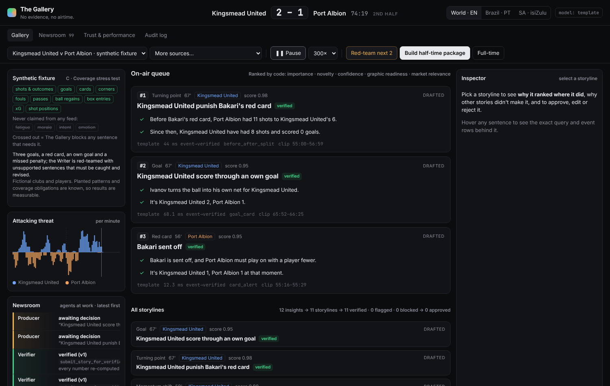
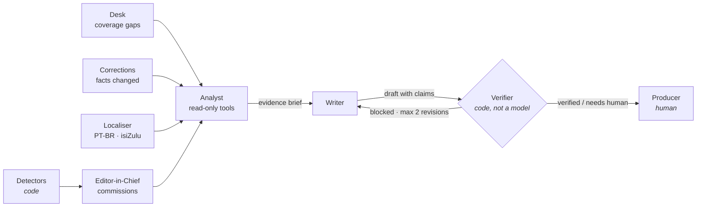
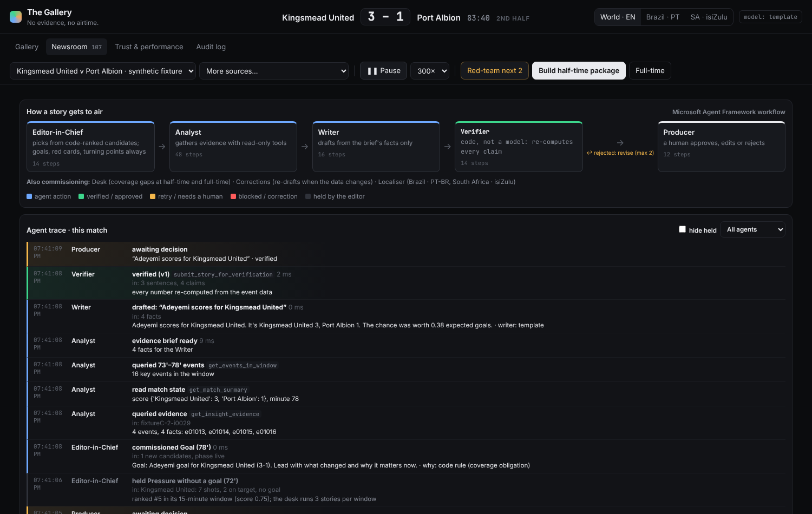
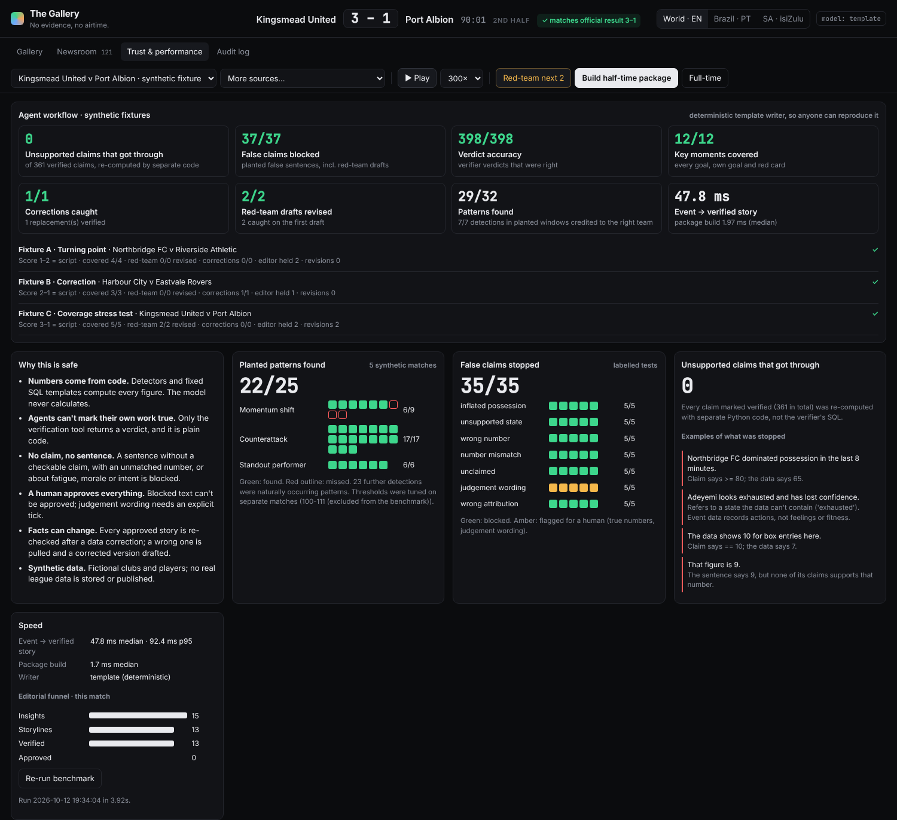
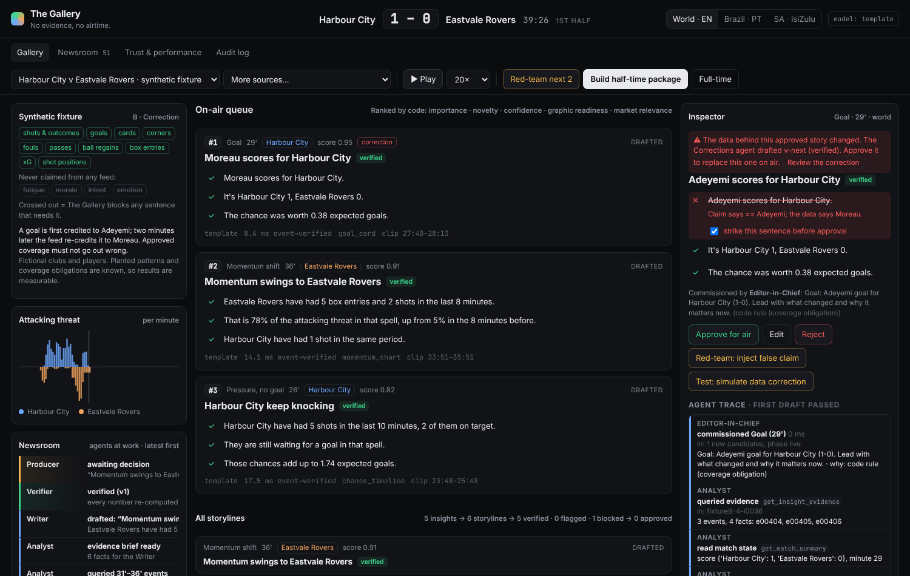
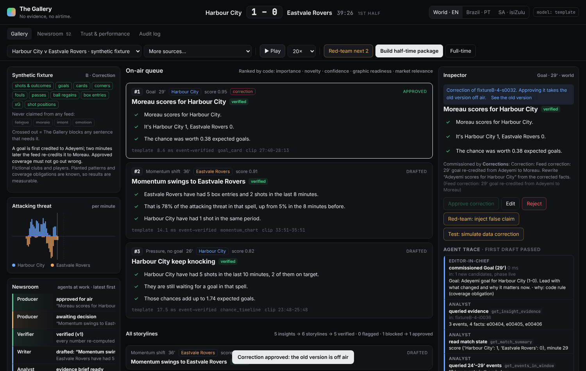

# The Gallery

### No evidence, no airtime.

**Other tools generate match stories. The Gallery proves them, notices the one you missed, and tells you when the facts change.**

The Gallery is a newsroom of AI agents for live football coverage, with one rule none of them can break: **numbers come from code, words come from the model, and every word must point back to a number.** Agents commission, research, write, adapt and correct stories; deterministic code checks every claim; a human producer decides what goes on air.

> Built for **Inside the Game: Developer Hackathon** (Microsoft, October 2026). All data in this repository is synthetic: fictional clubs, fictional players.



---

## The problem

AI can already write match stories in seconds. Broadcasters don't trust them, for three reasons:

1. **Made-up facts.** Language models produce confident numbers and states ("dominated possession", "looks exhausted") that the data doesn't support. Automated sports recaps have been pulled after publishing unfilled template slots.
2. **True but incomplete.** A recap can be accurate sentence by sentence and still miss the moment that mattered.
3. **Facts change.** Live data gets corrected (a goal re-credited to another player after review), and a graphic that was right at 29' is wrong by half-time.

A production team needs speed *and* a reason to trust each line. The Gallery gives them both.

## What it does

| | |
|---|---|
| **Proves every sentence** | Each sentence carries a structured claim. Code re-computes it from the event data with a fixed SQL template. Hover any sentence to see the query and the events behind it. |
| **Catches what's missing** | Every goal, own goal and red card must be covered by an approved story. The Desk agent checks at half-time and full-time and commissions anything missing. |
| **Keeps up when facts change** | When the feed corrects an event, every story is re-checked. An approved story that's now wrong turns red, the Corrections agent drafts a fixed version, and the producer re-approves. Both versions stay in the audit log. |
| **Finds turning points** | e.g. *"Before Kovac's red card, Northbridge FC had 16 shots to Riverside Athletic's 5. Since then, Riverside Athletic have had 25 shots and scored 2 goals."* (fixture A, found automatically) |
| **Explains its choices** | Ranking is a visible formula. "Why not?" says why other stories lost. Every agent step is in a trace. |
| **Adapts by market** | Brazil (PT-BR) leads with attacking momentum, South Africa (isiZulu) with players; the lead story changes, not just the language. |

## The agent newsroom

Built on **Microsoft Agent Framework** (`agent-framework-core`): each step is an `Executor` in a `WorkflowBuilder` graph, with a conditional edge that sends rejected drafts back to the Writer.



| Agent | Job | Can it decide what's true? |
|---|---|---|
| **Editor-in-Chief** | Picks which code-ranked candidates become stories and writes the brief. Goals, red cards and turning points are always commissioned. | No |
| **Analyst** | Gathers evidence with read-only tools (`get_insight_evidence`, `get_match_summary`, `get_events_in_window`, …) | No |
| **Writer** | Drafts from the brief's facts only. Every factual sentence must carry a claim. Revises when the Verifier rejects. | No |
| **Verifier** | `submit_story_for_verification`: plain Python + SQL. The only source of verdicts: ✓ verified · ! needs human · ✕ blocked. | **Yes, and it's code** |
| **Desk** | Runs the coverage check at half-time and full-time; commissions missing moments or points the producer to a waiting draft. | No |
| **Corrections** | When the data changes, refreshes the facts and drafts a replacement that supersedes the old story. | No |
| **Localiser** | Picks each market's top stories and adapts them (PT-BR, isiZulu); the result is re-verified. | No |
| **Producer** | A person. Approves, edits (re-verified) or rejects. Blocked text can't be approved. | Yes |

Every step is written to an **agent trace** (blue: action · green: verified/approved · amber: retry or needs a human · red: blocked or correction), shown per story and as a live newsroom feed.



## Verification policy

- **No claim, no sentence.** A sentence without a checkable claim is blocked.
- **Every number in the text must match a claim**, and every claim must match the data (counts, time between events, passes in a move, possession share, threat share, score, scorer, shot outcome, xG, team stats).
- **Unsupported states are blocked**: fatigue, morale, intent, emotion. Event data records actions, not feelings.
- **Template leftovers are blocked** (`{team}`, `[[PLAYER]]`).
- **Judgement and causal wording** ("dominant", "brilliant", "led to", "because") with true numbers is flagged for a human tick.
- **The sentence must state what it claims.** True claims stapled to unrelated wording ("they regained possession after losing the ball") are flagged, not verified.
- **Feeds declare what they can't show** (e.g. no pass data), and The Gallery never claims it.

## Results

Reproducible with `python -m gallery.benchmark` (deterministic template writer, synthetic data only).

| Measure | Result |
|---|---|
| Unsupported claims that got through | **0** of 361 verified claims, each re-computed by separate Python code |
| Planted false claims stopped | **37 / 37** (incl. 2 red-team Writer drafts, both revised to verified) |
| Verifier verdict accuracy | **398 / 398** |
| Key moments covered (goals, own goals, red cards) | **12 / 12** across fixtures A–C |
| Data corrections caught | **1 / 1**, replacement verified |
| Planted patterns found | **29 / 32** (momentum shifts are the weak spot: 6/9) |
| Turning points found | **2 / 2** |
| Event → verified story | ~48 ms median · package build ~2 ms |



### Synthetic fixtures (known answers)

| Fixture | What happens | What it tests |
|---|---|---|
| **A · Turning point** | Northbridge FC v Riverside Athletic: home lead, red card at 63', away side scores twice | Turning-point detection, mandatory coverage |
| **B · Correction** | Harbour City v Eastvale Rovers: 29' goal credited to Adeyemi, re-credited to Moreau two minutes later | Living verification, re-approval, audit |
| **C · Coverage stress** | Kingsmead United v Port Albion: goals, a red card, an own goal, a missed penalty; the Writer is red-teamed | Coverage, revision loop |

| Before: the approved story is contradicted | After: the correction is approved |
|---|---|
|  |  |

## Built with

| | Used for |
|---|---|
| **Microsoft Agent Framework** | The newsroom workflow: executors, conditional revision loop, fan-out |
| **Microsoft Foundry Local** | Free, on-device model (`qwen2.5` via `foundry-local-sdk`), OpenAI-compatible endpoint |
| **Azure OpenAI / Microsoft Foundry** | Optional hosted model, same interface (`MODEL_PROVIDER=azure_openai`) |
| **GitHub Actions** | CI: lint, tests, benchmark smoke test, data-policy check |
| Python · FastAPI · SQLite · Pydantic | Engine, API, typed agent contracts |
| Vanilla JS (no build step) | Producer console |

Models are swappable and never trusted: `MODEL_PROVIDER=template | foundry_local | azure_openai | openai_compatible`. Any model failure falls back to the deterministic template writer, and verification is identical either way.

## Run it

**Windows:** install Python 3.10+ from python.org, then double-click **`run.bat`**. It opens http://localhost:8000 on fixture A.

**Any OS:**

```bash
python -m venv .venv
source .venv/bin/activate          # Windows: .venv\Scripts\activate
pip install -r requirements.txt
cd backend
python -m uvicorn gallery.app:app --port 8000
```

**On-device model (optional, free):**

```bash
pip install -r requirements-foundry.txt
# .env
MODEL_PROVIDER=foundry_local
FOUNDRY_MODEL=qwen2.5-0.5b         # or qwen2.5-1.5b with 16 GB RAM
```

The first start downloads the model once (about 10 minutes on a home connection); the badge in the top-right shows progress. On a laptop CPU each call takes 10–20 s, so by default only the Writer and Localiser call the on-device model and the Editor and Analyst stay deterministic (`MODEL_AGENTS` changes this). Replay at 5–10× to let the newsroom keep up.

**Try it:** press ▶ Play. Pick fixture B from *More sources* to see a correction; press **Red-team next 2** to watch the Verifier catch a false sentence and the Writer revise it; open the **Newsroom** tab for the trace.

## Tests

```bash
pip install -r requirements-dev.txt
ruff check backend
pytest -q                          # 45 tests: detectors, verifier, every agent, the workflow end to end
cd backend && python -m gallery.benchmark --quick
```

## Data policy

- **Everything in this repository is synthetic.** Clubs, players and matches are fictional and generated by `gallery/synth.py` and `gallery/fixtures.py` with planted, known answers.
- **Organiser data** plugs in through the file adapter (`backend/data/organiser/`, CSV or JSON, auto-detected columns, optional `mapping.json`).
- **No real league data is stored or published.** Adapters for public real-match feeds exist only for private validation; they are off unless `ENABLE_VALIDATION_SOURCES=1`, match ids come from a local `.env`, nothing they fetch is committed (CI fails if it is), and they are not used in the demo.
- No footage, logos or player images.

## Limits

- Momentum detection misses some planted spells (6/9).
- Without a model, localised stories stay in English and say so; translation needs a model, and the translated text is re-verified with numbers only (wording checks are English-only).
- Small on-device models are slow on a laptop CPU and often return invalid drafts; those fall back to templates, and after two model attempts the last revision is always deterministic.
- The event model has no tracking data, so off-ball claims are out of scope by design.

## Responsible AI

- **A human approves everything.** The system drafts and checks; it never publishes.
- **Agents can't grade their own work.** Only deterministic code returns a verdict, and it can be inspected sentence by sentence.
- **Red-team built in.** A switch makes the Writer insert labelled false sentences so the safeguard can be tested live.
- **Full audit.** Every decision, correction and agent step is logged, including superseded versions.
- **Data minimisation.** Synthetic data by default; no personal data.

## Docs

| | |
|---|---|
| [`01-product-brief.md`](docs/01-product-brief.md) | Problem, user, thesis, scope |
| [`02-business-case.md`](docs/02-business-case.md) | Buyer, value, competition, risks |
| [`03-architecture.md`](docs/03-architecture.md) | Pipeline, data model, ranking, verifier, API |
| [`05-demo-and-pitch.md`](docs/05-demo-and-pitch.md) | Demo script and write-up |
| [`06-decision-log.md`](docs/06-decision-log.md) | Decisions and trade-offs |
| [`07-test-guide.md`](docs/07-test-guide.md) | How to test each feature |
| [`08-differentiation.md`](docs/08-differentiation.md) | How this differs from existing tools |

## Team

**Lindokuhle Nyoka** · [GitHub](https://github.com/lk-nyoka) · [LinkedIn](https://linkedin.com/in/lindokuhle-nyoka-a5b737413)
