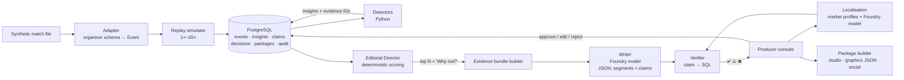
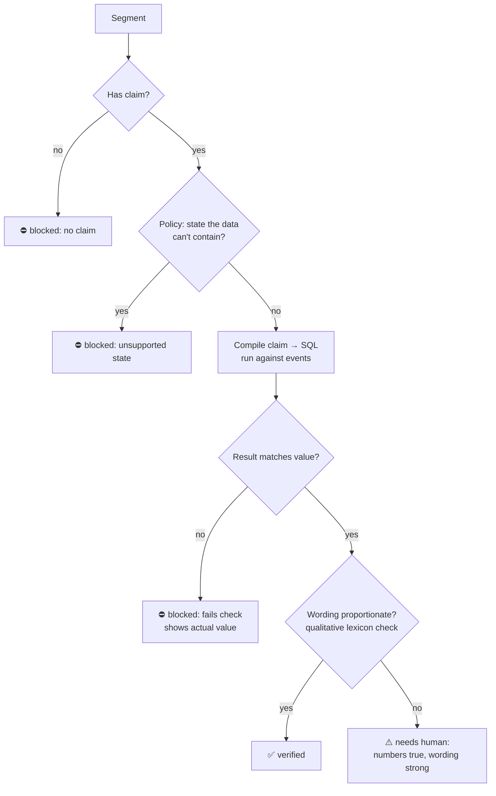

# 03 · Architecture

**Status:** v2 locked · 12 October 2026 · organiser schema adapter pending

**What changed in v2:** ranking is now deterministic (no LLM decides what matters); the Writer only ever sees an evidence bundle and must emit claims per sentence; verification is pure code; the MVP runs on a much smaller Azure footprint; added "Why not?", evidence chains, evidence hover-cards and graphics payloads.

---

## 1. Design principles

1. **Numbers from code, words from the model.** Detection, scoring and verification are deterministic Python/SQL. The LLM writes and localises. Nothing else.
2. **The model never touches raw data.** The Writer receives an evidence bundle (selected events + computed metrics). It cannot cite what it wasn't given.
3. **Claims are structural, not extracted.** Every factual sentence is born with a machine-checkable claim. A sentence without one is blocked.
4. **Humans decide.** Only producer-approved items enter a package. Every decision is audited.
5. **Prove it.** The same pipeline runs live and in the benchmark.
6. **Local-first.** The full loop runs with Docker Compose; Azure services are added where they visibly improve the product.

## 2. Pipeline



Per storyline there is **one** LLM call (Writer), plus one per extra market (Localisation). Everything else is code, so the path from triggering event to verified storyline stays within a few seconds.

## 2a. Agent workflow (Microsoft Agent Framework)

`backend/gallery/agents/` turns detected insights into stories. Code in `workflow.py` builds the graph with `WorkflowBuilder`:

```
Dispatch ─▶ Analyst ─▶ Writer ─▶ Verifier ─┬─▶ ProducerGate (register story, await a human)
                         ▲                 │
                         └── blocked, ≤ 2 ─┘
```

| Module | Role |
|---|---|
| `contracts.py` | Pydantic contracts: `StoryCommission`, `EvidenceBrief`, `StoryDraft` (needs ≥ 1 segment), `Claim`, `VerificationResult`, `AgentTraceEvent` |
| `editor.py` | Editor-in-Chief: ranks each new insight in its own 15-minute window at detection time; goals, red cards, turning points always commissioned; top 3 optional per window eligible; a model (if any) chooses and briefs from validated ids |
| `analyst.py` | Calls read-only tools and returns an `EvidenceBrief` (facts are code-computed claims) |
| `writer.py` | Model draft from the brief's facts only (one retry on invalid JSON, then template); revision prompt with the Verifier's guidance; red-team mode inserts one labelled false sentence in v1 |
| `tools.py` | Read-only tools + `submit_story_for_verification` (the only verdict source) + `refresh_facts` |
| `desk.py` | Coverage check at half-time / full-time → commission or "waiting for producer" |
| `corrections.py` | After a data correction: refresh facts, commission a replacement with `supersedes` |
| `localiser.py` | Market top-N → localisation commissions; output re-verified |
| `newsroom.py` | Triggers (new insights, period end, correction, localise) and one-batch-at-a-time execution |
| `trace.py` | `agent_trace` table + live WebSocket events |

Model access goes through `gallery/llm.py` (`MODEL_PROVIDER`: template, foundry_local, azure_openai, openai_compatible). Every failure falls back to templates.

## 3. Components

| # | Component | Responsibility | Tech | Phase |
|---|---|---|---|---|
| 1 | Adapter | Map organiser data to the minimal `Event` interface | Python | Core |
| 2 | Replay simulator | Stream a stored match at 1×–20× | Python | Core |
| 3 | Store | Events, insights, claims, decisions, packages, audit | PostgreSQL (SQLite for tests) | Core |
| 4 | Detectors | Rolling-window pattern detection | Python, pandas | Core: 3 · later: 5 |
| 5 | Editorial Director | Score and rank insights; keep scores for rejected ones | Python | Core |
| 6 | Evidence bundle builder | Assemble the only material the Writer may use | Python | Core |
| 7 | Writer | Headline + segments, each with a claim; graphic spec; clip cue | Foundry, Azure OpenAI model, strict JSON schema | Core |
| 8 | Verifier | Re-compute each claim against the store; assign verdict | Python + SQL | Core |
| 9 | Console API | REST + WebSocket push | FastAPI on Container Apps | Core |
| 10 | Producer console | Control-room UI | React + Vite on Static Web Apps | Core |
| 11 | Package builder | Half-time / full-time packages, graphics payloads, social copy | Python | Core |
| 12 | Localisation | Market-profile-driven rewrite; output re-verified | Foundry model + glossary | Core (EN, PT-BR) · then isiZulu |
| 13 | Benchmark | Fixture matches, injected patterns, false claims, evaluator | Python | Core (small) |
| 14 | Live-state store | Low-latency match state | Cosmos DB | Later |
| 15 | Retrieval | Glossary, style guide, market profiles | Azure AI Search | Later |
| 16 | Benchmark analytics | Results lakehouse + report | Microsoft Fabric | Later |
| 17 | Ingestion at scale | Streaming feed | Event Hubs | Stretch |
| 18 | Observability | Latency, tokens, errors per stage | Application Insights | Core |

## 4. Data model

### Minimal Event interface (adapter target)

Required: `event_id`, `match_id`, `period`, `minute`, `second`, `team_id`, `type`, `outcome`.
Optional: `player_id`, `x`, `y`, `end_x`, `end_y`, `xg`, `related_event_ids`, `possession_id`, `raw`.

The system must run on the required fields alone. Optional fields unlock richer evidence (pitch graphics, evidence chains, shot quality).

### Insight

```json
{
  "insight_id": "ins-0091",
  "match_id": "m001",
  "detector": "counterattack",
  "window": {"from_s": 3720, "to_s": 3734},
  "team_id": "T_HOME",
  "player_ids": ["P_007", "P_011"],
  "metrics": {"seconds_regain_to_shot": 14, "passes": 3, "start_zone": "own_half"},
  "evidence_event_ids": ["m001-e0451", "m001-e0452", "m001-e0455", "m001-e0457"],
  "confidence": 0.86
}
```

### Writer output (strict schema)

```json
{
  "storyline_id": "st-0042",
  "headline": "Home punish the turnover in fourteen seconds",
  "segments": [
    {
      "text": "Home went from winning the ball in their own half to a shot in fourteen seconds.",
      "claim": {
        "kind": "sequence",
        "metric": "seconds_regain_to_shot",
        "team_id": "T_HOME",
        "window": {"from_s": 3720, "to_s": 3734},
        "op": "==",
        "value": 14,
        "evidence_event_ids": ["m001-e0451", "m001-e0457"]
      }
    }
  ],
  "graphic": {"template": "sequence_timeline", "event_ids": ["..."]},
  "clip_cue": {"from_s": 3715, "to_s": 3740, "label": "Counterattack, 62'"}
}
```

Validation: invalid JSON or a segment without a claim → retry once; if it fails again, the segment is **blocked** and the storyline is shown with that segment struck out.

### Other tables

| Table | Key fields |
|---|---|
| `storylines` | storyline_id, match_id, phase, score, rank, market, status (`candidate` / `drafted` / `approved` / `rejected`) |
| `rank_explanations` | storyline_id, factor, value, weight, contribution (feeds "Why not?") |
| `claims` | claim_id, storyline_id, segment_idx, kind, assertion, evidence_event_ids, verdict, reason, sql, rows_returned |
| `decisions` | decision_id, storyline_id, actor, action, before, after, at |
| `packages` | package_id, match_id, kind, market, storyline_ids, recap, graphics_json, social_copy, built_ms |
| `market_profiles` | market, language, focus_players, focus_teams, depth, glossary, graphic_emphasis, forbidden_framings |
| `benchmark_truth` | match_id, pattern_type, team_id, window, planted_event_ids |
| `benchmark_results` | run_id, metric, value, detail |

## 5. Detectors

Build order: the first three must be solid before adding the rest.

| # | Detector | Signal (events-only) | Evidence |
|---|---|---|---|
| 1 | **Momentum shift** | Change in a team's attacking share (final-third passes, box entries, shots) vs the previous window | Box entries, shots, final-third passes in window |
| 2 | **Counterattack** | Regain in own half → shot or box entry within N seconds and ≤ K passes | Full sequence |
| 3 | **Standout performer** | Player involvement/output well above team baseline in window | Player's key events |
| 4 | Pressing spell | Burst of defensive actions in opponent half with high regain rate | Defensive actions + regains |
| 5 | Goal-threat build-up | Rising shot volume/quality without a goal (xG if present, location proxy otherwise) | Shots |

Thresholds are tuned on non-benchmark matches only.

**Evidence chains:** where `related_event_ids` or possession sequences exist, the console can expand a moment backwards (goal ← shot ← carry ← interception). This is a simple walk over linked events, not a graph database.

## 6. Editorial Director (deterministic ranking)

```
score = 0.30·importance + 0.20·novelty + 0.20·confidence + 0.15·visual_clarity + 0.15·market_relevance
```

| Factor | Computed from |
|---|---|
| importance | Detector type weight × game state (score margin, minute, phase) |
| novelty | Penalty if a similar storyline (same detector, team, player) was already promoted in this match |
| confidence | Detector confidence |
| visual_clarity | Whether a graphic template and clip cue exist for it |
| market_relevance | Overlap with the market profile's focus players/teams |

Weights live in config and are shown in the UI. The top N (default 3) become storylines; all others are kept with their factor breakdown.

**"Why not?"**: for any storyline, the console shows the next-best candidates and which factors held them back, e.g. *"Possession dominance: possession advantage +3%, no increase in shots, confidence 0.41."* All numbers come from the stored scores; the model only phrases them.

## 7. Verifier



| Verdict | Meaning |
|---|---|
| ✅ `verified` | The assertion is true and the wording contains no unsupported intensifiers |
| ⚠️ `needs_human` | Numbers check out, but the wording is qualitative or comparative ("dominant", "relentless", "best") |
| ⛔ `blocked` | No claim, failed check, or a state the data cannot contain (fatigue, morale, intent, emotion) |

- Claim kinds: `count`, `rate`, `comparison`, `sequence`, `attribution`. Each compiles to a parameterised SQL template; no free-form SQL from the model.
- The qualitative check is a lexicon in MVP (fast, deterministic). An LLM judge is a later option, only ever able to downgrade to `needs_human`, never to upgrade.
- Every result stores the SQL and the rows returned, which power the **evidence hover-card**.
- Edits by the producer and localised versions go through the verifier again.
- A storyline is approvable when no segment is `blocked`; `needs_human` segments require an explicit tick from the producer (logged).

## 8. Localisation

Market profiles are data, not prompts:

| Field | EN (world feed) | PT-BR | ZU (community stream) |
|---|---|---|---|
| Lead-story preference | Highest overall score | Boost focus players from the market | Boost focus players + local framing |
| Depth | Analyst | Broadcast | Community / casual |
| Glossary | House style | Brazilian broadcast terms | Reviewed isiZulu football terms |
| Graphic emphasis | Momentum chart | Player card | Sequence timeline |
| Forbidden framings | Player states, speculation | Same | Same |

Flow: Editorial Director re-ranks with the market's `market_relevance` → Writer/Localisation writes in the target language using the glossary → verifier re-checks every claim. Because ranking changes per market, the **lead story** can change, which is the point of the demo.

isiZulu output is reviewed by a native speaker before recording. We will not claim broadcast-grade translation.

## 9. Producer console

Visual direction follows Refero Styles references: dense, calm, high contrast, dark-first.

| Area | Content |
|---|---|
| Top bar | Match, score, clock, replay speed, market switch, 90-second half-time countdown |
| Left | Event timeline, momentum strip |
| Centre | Ranked storylines; each segment shows ✅ ⚠️ ⛔ inline |
| Hover-card | Claim → SQL → returned rows (e.g. *64' Interception #4891 → Carry → Shot #4892*) |
| Right | "Why not?" panel, evidence chain, approve / edit / reject |
| Bottom | Package preview: studio script, graphics payload, social copy; "Copy graphics payload" |
| Trust tab | Benchmark bars (truth vs detected vs missed), blocked false claims with reasons, editorial funnel, latency |

**Graphics payload:** each approved item exports a JSON payload (template, fields, values, event IDs) and a simple HTML lower-third preview, the shape a graphics engine would consume. We don't claim integration with any specific vendor.

## 10. API

| Method | Path | Purpose |
|---|---|---|
| POST | `/matches/{id}/replay` | Start replay `{speed}` |
| WS | `/matches/{id}/stream` | Events, insights, storylines, verdicts |
| GET | `/storylines/{id}` | Storyline, segments, claims, verdicts |
| GET | `/storylines/{id}/why-not` | Alternatives and factor breakdown |
| GET | `/claims/{id}/evidence` | SQL, rows, evidence chain |
| POST | `/storylines/{id}/decision` | `{action, edits?}` |
| POST | `/matches/{id}/packages` | `{kind, market}` |
| GET | `/benchmark/latest` | Benchmark results |

## 11. Benchmark (fixed test suite)

No dynamic generator. Instead:

1. Take **5** organiser matches (separate from those used for tuning).
2. A small script **injects 10 known patterns** into copies (e.g. insert a regain → 3 passes → shot sequence at 61'); ground truth saved alongside.
3. Write **20 false claims** by hand (wrong counts, wrong team, unsupported states, inflated wording).
4. Evaluator replays all 5 at max speed and reports:

| Metric | Definition |
|---|---|
| Pattern recall | planted patterns found / planted |
| Pattern precision | correct detections / all detections in the injected windows |
| False-claim block rate | planted false claims blocked or flagged / 20 |
| Unsupported-claim escape rate | `verified` claims that fail an independent re-check / all `verified` |
| Median time-to-storyline | triggering event → verified storyline |
| Package build time | request → completed half-time package |
| Editorial funnel | insights → storylines → approved (demo session) |

Results are published in the repo with the method, so they can be reproduced. Numbers in the pitch come only from this run.

## 12. Engineering

| Concern | Choice |
|---|---|
| Local dev | Docker Compose: Postgres, API, console |
| Deploy | Container Apps + Static Web Apps + Azure Database for PostgreSQL via `azd` |
| CI | GitHub Actions: lint, unit tests per detector, verifier tests, benchmark smoke run |
| Secrets | Managed identity where possible; Key Vault otherwise |
| Responsible AI | Model never sees raw data; claims verified by code; human approval; Content Safety on generated text; all output labelled AI-assisted and producer-approved |

## 13. Roadmap (pitch only, not built)

The verified insight stream is consumer-agnostic. After the studio, the same engine could feed digital/app notifications, social desks and partner APIs, and cover pre-match and post-match windows. Contradiction detection between storylines (e.g. two claims about control of the same window) is the next verifier feature.

## 14. Open questions

| Question | Affects | Status |
|---|---|---|
| ⛔ Organiser dataset schema (events only? positions? xG? linked events?) | Adapter, detectors, evidence chains | Waiting |
| ⛔ Required/weighted Microsoft services in the rules | §3 phasing | Read rules |
| Can organiser data be committed publicly? | `data/`, benchmark publication | Read rules |
| Submission format and video length | Demo | Read rules |
